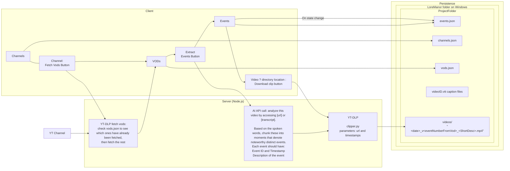

This is a extract software to events from Discord, In-game and livestreams and convert them into ordered dated descriptioned events with an intuitive UI

It is a System that Automatically Extract clippable moments from livestreams , and save them as events that happened with the mp4 for each clip
Ideally keeping everything in chronological order to make it VERY EASY to allocate these into storyline videos

This is a frontend ui that hooks directly into your windows folder.

# Data Model and Flow

## Data Model

Each collection is stored as a JSON array in the active project directory. The
client and server share the definitions in [shared/types/api.ts](shared/types/api.ts).

### Channel (`channels.json`)

- `channelURL` (`string`) — YouTube channel URL.
- `channelName` (`string`) — Display name, inferred from the URL when possible.

### VOD (`vods.json`)

- `videoID` (`string`) — YouTube video ID used to merge fetched VODs and link events.
- `videoURL` (`string`) — YouTube watch URL.
- `datetime` (`string`) — Start or release time as an ISO 8601 UTC string. Fetching falls back to an upload or release date at midnight UTC, or an empty string when no date is available.
- `vodTitle` (`string`) — Video title.
- `thumbnailURL` (`string`) — Preview image URL.

### Event (`events.json`)

- `eventID` (`string`) — Event identifier.
- `sourceType` — `VOD`, `manual`, or `Discord`.
- `vodId` (`string` or `null`) — Source VOD's `videoID`, or `null` when the event has no source VOD.
- `datetime` (`string` or `null`) — Absolute timeline time in ISO 8601 format, or `null` when unavailable. For extracted events, this is the VOD datetime plus `starttime`.
- `starttime` (`string`) — Start offset within the VOD in `HH:MM:SS.mmm` for extracted events. Manual events use an empty string.
- `endtime` (`string`) — End offset within the VOD in `HH:MM:SS.mmm` for extracted events. Manual events use an empty string.
- `description` (`string`) — Text describing what happened.
- `shortsViable` (`boolean` or `null`) — Suitability for a short-form clip, or `null` when unset.
- `allocatedTracks` (`string[]`) — Allocation track names such as `Story` and `Devlog`.
- `projectAllocations` (`string[]`) — Associated video project IDs (`projectID`).

### Allocation Track (`allocation-tracks.json`)

Each entry is a non-empty string naming a track. The main Events lanes are
`Story` and `Devlog`.

### Video Project (`projects.json`)

- `projectID` (`string`) — Project identifier.
- `projectName` (`string`) — Display name.
- `projectType` — `Storyline` or `Devlog`.
- `eventIDs` (`string[]`) — Event identifiers (`eventID`) included in the project.

## Data Model and Flow Diagram

The persistence layer is currently a Windows folder containing the JSON data,
caption files, and extracted video clips shown below.



### Recommendations

- Use a single canonical schema for frontend state and persisted JSON so field
  names and types cannot drift between the client and server.
- Add stable identifiers and explicit relationships, such as a `channelId` on
  VODs, following the existing `vodId` relationship on events.
- Store timestamps in one documented format, preferably ISO 8601 in UTC, and
  validate that event start and end times fall within the source VOD.
- Define how concurrent state changes are handled when more than one process
  writes to the Windows folder.
- Consider a small schema version in each JSON file to support future migrations.


## Project Structure

- `client/` contains the React 19 and Vite frontend.
- `server/` contains the Node.js and Express API.
- `shared/` contains types and contracts used by both applications.
- `DESIGN_LANGUAGE.md` defines the "Manor Timber & Aged Brass" design system and CSS tokens implemented in `client/src/index.css` and `client/src/App.css`.

The frontend and API are independent npm workspaces. The Vite development server proxies `/api`
requests to Express on port `3001`.

## Main Workspace UI

- The main page has three primary vertical tracks: **Channels**, **VODs**, and
  **Events**. They are independently scrollable and remain usable when additional
  allocation tracks are shown.
- The Events track is ordered chronologically. Events derived from VODs or other
  external sources are locked in the timeline and cannot be manually reordered.
  A horizontal divider with a **+** button appears between each pair of event
  cards to insert a `sourceType: "manual"` event whose starting datetime is the
  midpoint between the event above and the event below. Manually added events
  can be dragged and dropped anywhere in the timeline with live predictive
  snapping; releasing the mouse confirms the new position and updates the
  event's datetime to the midpoint of its new neighbors.
- The Events track contains two side-by-side allocation lanes: **Devlog** on
  the left and **Story** on the right. Events belong to at least one lane;
  events with no Story or Devlog allocation default to Devlog.
- Each VOD has an ID-based color shared by its card's left bar, its connector
  lines, and the left bars of its event cards in all allocation tracks.
  Connector lines are clipped to the vertical bounds of the event-card
  scrolling area and fade out over 28 pixels at its top and bottom edges,
  keeping headers and the space below the tracks clear.
- An event may be allocated to both Story and Devlog and may reference one or
  more video projects through `projectAllocations`.
- Use **Edit** on an event card to save a new description or **Delete** to
  remove the event after confirmation. Deleting does not remove the source VOD,
  transcript, or clips. Re-extracting a VOD replaces its existing event set.
- Event cards show the event date, local time, and clip duration, use the
  source VOD's thumbnail as a background image fading out from left to right,
  and include a YouTube button that opens the source video at the event's start
  timestamp.
- Click the YouTube Shorts icon on an event card to toggle `shortsViable` in
  `events.json`. The icon is red when marked and gray when unmarked.
- In the allocation lanes, drag an event card's edge across the divider to
  expand it into both lanes or shrink it back to one.
  The card's Story/Devlog membership is saved in `allocatedTracks` in `events.json`.
- Video projects are an optional grouping layer. A project has a project type of
  **Storyline** or **Devlog** and contains references to event IDs.
- The initial frontend state is empty until channel information is fetched or
  persistence JSON files exist. The UI must not invent sample channels, VODs,
  events, or projects.
- The Settings dialog stores the active project's absolute Windows directory in
  browser local storage. The directory can be updated or cleared from the same dialog.
- Domain data is persisted through `PUT /api/persistence/:collection`. Supported
  collections map to `channels.json`, `vods.json`, `events.json`,
  `allocation-tracks.json`, and `projects.json` in the active project directory.
  The server validates each payload and replaces JSON files atomically.
- Channels are loaded from `channels.json` when a project directory is selected.
  Adding a channel saves the updated channel list through the persistence API;
  the name is inferred from the URL when possible and may be overridden.
- Use **Fetch VODs** on a channel to retrieve its YouTube streams with `yt-dlp`.
  Full video metadata is fetched so livestream dates are included. New videos
  are merged by video ID into the existing VOD collection and saved through the
  persistence API to `vods.json`; existing VODs are loaded when the project
  directory is selected. Server terminal logs show fetch stages and each VOD
  whose metadata is retrieved. The server requires `yt-dlp` on `PATH`.
- Configure a Gemini API key in **Settings** to enable **Extract events** on
  each VOD. The server fetches English captions with `yt-dlp`, caches them as
  `<videoID>.vtt` in the active project directory, and reuses a non-empty cached
  transcript on later extractions. Gemini-generated events are validated,
  normalized to the shared event schema, merged into `events.json`, and shown
  in the Events track. The API key remains in browser local storage and is sent
  to the server only with an extraction request; it is not written to project
  files or server logs. Event extraction uses `gemini-3.5-flash-lite`, Google's
  high-throughput Flash-Lite model, to keep transcript processing costs low
  while retaining the structured-output capability required by the prompt. The
  server build copies the extraction prompt alongside the compiled application.


# Persistence
Recommended flow:

The server loads JSON when the project directory is selected.
The client holds the loaded data in React state.
User actions update React state immediately.
Completed actions trigger an API save:
Add/remove a channel
Reorder an event
Assign an allocation
Create/update a project
Text editing saves on submit, blur, or with a short debounce.
The server writes atomically using a temporary file followed by rename.


## Development

Install dependencies and start both applications:

```powershell
npm install
npm run dev
```

The frontend is available at `http://localhost:5173`. The API is available at
`http://localhost:3001/api`.

## Other Commands

```powershell
npm run build
npm run lint
```


# React + TypeScript + Vite

This template provides a minimal setup to get React working in Vite with HMR and some Oxlint rules.

Currently, two official plugins are available:

- [@vitejs/plugin-react](https://github.com/vitejs/vite-plugin-react/blob/main/packages/plugin-react) uses [Oxc](https://oxc.rs)
- [@vitejs/plugin-react-swc](https://github.com/vitejs/vite-plugin-react/blob/main/packages/plugin-react-swc) uses [SWC](https://swc.rs/)

## React Compiler

The React Compiler is not enabled on this template because of its impact on dev & build performances. To add it, see [this documentation](https://react.dev/learn/react-compiler/installation).

## Expanding the Oxlint configuration

If you are developing a production application, we recommend enabling type-aware lint rules by installing `oxlint-tsgolint` and editing `.oxlintrc.json`:

```json
{
  "$schema": "./node_modules/oxlint/configuration_schema.json",
  "plugins": ["react", "typescript", "oxc"],
  "options": {
    "typeAware": true
  },
  "rules": {
    "react/rules-of-hooks": "error",
    "react/only-export-components": ["warn", { "allowConstantExport": true }]
  }
}
```

See the [Oxlint rules documentation](https://oxc.rs/docs/guide/usage/linter/rules) for the full list of rules and categories.


# For users

Prerequisites: yt-dlp --update
nodejs
